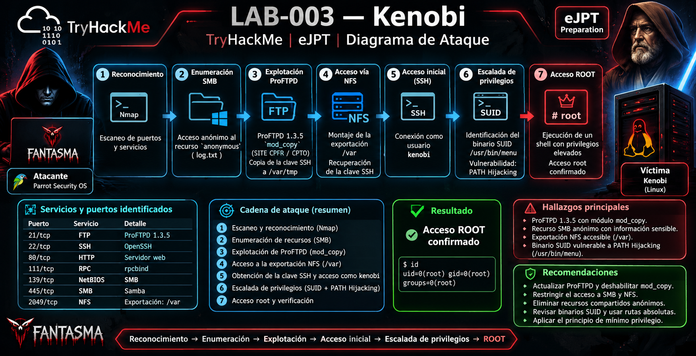

# LAB-003 — Kenobi | TryHackMe

## 1. Información del laboratorio

| Campo | Descripción |
|---|---|
| Laboratorio | LAB-003-KENOBI |
| Plataforma | TryHackMe |
| Máquina | Kenobi |
| Objetivo | Obtener acceso inicial y escalar privilegios |
| Sistema atacante | Parrot Security OS |
| Herramientas | Nmap, smbclient, showmount, SearchSploit, Netcat, SSH |
| Resultado | Acceso root confirmado |
| Fecha | 15/11/2026 |

**Autor:** FANTASMA  
**Repositorio:** LAB-003-Kenobi

## 2. Objetivos

- Identificar servicios y puertos abiertos.
- Enumerar recursos compartidos SMB.
- Analizar las exportaciones NFS.
- Identificar vulnerabilidades de ProFTPD.
- Obtener acceso SSH mediante una clave recuperada.
- Enumerar permisos SUID.
- Escalar privilegios hasta root.
- Documentar los hallazgos y las medidas correctivas.

## 3. Reconocimiento

### Escaneo Nmap

Se identificaron siete puertos TCP abiertos:

| Puerto | Servicio |
|---|---|
| 21 | FTP — ProFTPD 1.3.5 |
| 22 | SSH |
| 80 | HTTP |
| 111 | RPC |
| 139 | NetBIOS/SMB |
| 445 | SMB |
| 2049 | NFS |

Las evidencias del reconocimiento se encuentran en `02-Reconocimiento/`.

### Enumeración SMB

Se identificaron tres recursos compartidos:

- `print$`
- `anonymous`
- `IPC$`

En el recurso `anonymous` se encontró el archivo `log.txt`, que proporcionó información sobre la configuración del servidor y la ubicación de la clave SSH del usuario Kenobi.

### Enumeración NFS

Se identificó la exportación:

`/var`

Esta exportación permitió acceder a archivos del directorio compartido mediante un montaje NFS.

## 4. Análisis de vulnerabilidades

### ProFTPD 1.3.5 — mod_copy

Se identificó el módulo `mod_copy`, que permite copiar archivos mediante los comandos FTP:

- `SITE CPFR`: selecciona el archivo de origen.
- `SITE CPTO`: establece el destino de la copia.

Durante el laboratorio se comprobó que estos comandos podían utilizarse sin autenticación para copiar la clave SSH del usuario Kenobi a un directorio accesible mediante NFS.

**Impacto:** exposición de credenciales y acceso no autorizado.

## 5. Obtención de acceso inicial

La cadena de explotación fue:

1. Identificación del recurso SMB anónimo.
2. Descubrimiento de la ubicación de la clave SSH.
3. Identificación del módulo `mod_copy`.
4. Copia de la clave a `/var/tmp`.
5. Recuperación de la copia mediante NFS.
6. Conexión SSH como el usuario `kenobi`.

**Resultado:** acceso inicial obtenido.

Por seguridad, no se publican claves privadas ni credenciales.

## 6. Escalada de privilegios

### Enumeración SUID

Se identificó el ejecutable:

`/usr/bin/menu`

El archivo tenía permisos SUID y pertenecía a `root`.

El análisis del binario reveló llamadas a comandos del sistema, entre ellos `curl`, sin utilizar una ruta absoluta.

### Vulnerabilidad: PATH Hijacking

Se comprobó que el ejecutable podía resolver un comando desde un directorio controlado por el usuario.

Al modificar temporalmente la variable `PATH` dentro del laboratorio, se consiguió ejecutar un intérprete de comandos con privilegios elevados.

**Resultado confirmado:**

`uid=0(root)`

Se verificó la existencia de `/root/root.txt`.

## 7. Hallazgos de seguridad

| ID | Hallazgo | Severidad estimada |
|---|---|---|
| KEN-01 | Copia de archivos sin autenticación mediante ProFTPD mod_copy | Crítica |
| KEN-02 | Exposición de archivos mediante SMB y NFS | Alta |
| KEN-03 | Binario SUID vulnerable a PATH Hijacking | Crítica |

Las severidades son estimaciones educativas, no puntuaciones CVSS calculadas.

## 8. Recomendaciones

1. Actualizar ProFTPD y deshabilitar módulos innecesarios.
2. Restringir el acceso a los servicios FTP, SMB y NFS.
3. Eliminar los recursos compartidos anónimos innecesarios.
4. Aplicar controles de acceso adecuados a los archivos sensibles.
5. Revisar los binarios SUID personalizados.
6. Utilizar rutas absolutas al ejecutar comandos privilegiados.
7. Aplicar el principio de mínimo privilegio.
8. Supervisar accesos y actividades sospechosas.

## 9. Evidencias

Las evidencias públicas se organizan en:

- `02-Reconocimiento/`
- `03-Explotacion/`
- `04-Imagenes/`
- `05-Evidencias/publico/`
- `06-Comandos/`

Las evidencias privadas se conservan localmente en:

`05-Evidencias/privado/`

No se publican claves SSH privadas, contraseñas ni banderas de TryHackMe.

## 10. Conclusiones

El laboratorio Kenobi permitió practicar una cadena completa de pentesting:

**Reconocimiento → Enumeración → Explotación → Acceso inicial → Escalada de privilegios → Verificación → Documentación**

Se consiguió acceso al sistema como usuario `kenobi` y posteriormente como `root`.

El ejercicio demuestra cómo una configuración insegura de servicios de red, combinada con un binario SUID vulnerable, puede permitir el compromiso completo de un sistema Linux.

---

**FANTASMA | Formación práctica eJPT**

**Aviso legal:** Todas las pruebas se realizaron en un entorno de laboratorio autorizado de TryHackMe, exclusivamente con fines educativos.
